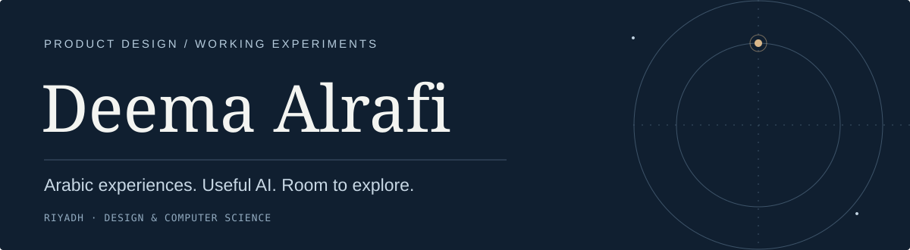
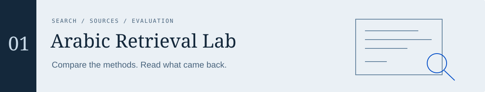
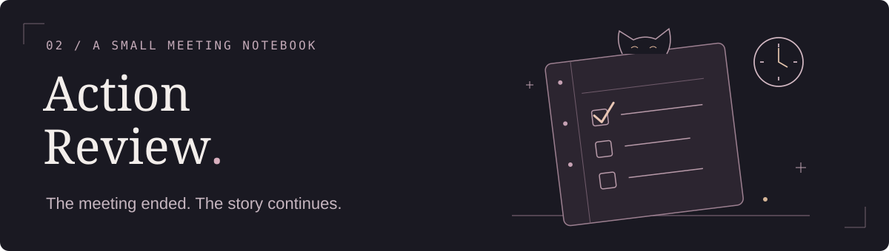
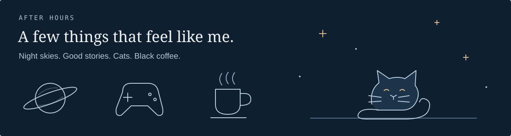

<picture>
  
</picture>

### Senior UI/UX Designer · Applied AI

I design internal products and build prototypes to test the ideas behind them. My background is in computer science; my work brings together research, product workflows and interface design.

I care about Arabic experiences, finding the right information, and what happens between an AI output and someone actually using it.

---

### Try something

**When a search looks right, how do you check it?** Compare Arabic lexical, semantic and hybrid retrieval. Open the actual passages and export the evidence.

[Open the experiment ↗](https://huggingface.co/spaces/Deema9/arabic-retrieval-lab) · [Code](https://github.com/cometeux/arabic-ai-quality-lab) · [What failed, and why](https://github.com/cometeux/arabic-ai-quality-lab/blob/main/docs/EVALUATION.md)

**The meeting ended. What happens next?** A small notebook for reviewing tasks, owners and deadlines. It flags gaps, keeps editing in your hands and exports the list.

[Open the notebook ↗](https://huggingface.co/spaces/Deema9/action-review) · [Code](https://github.com/cometeux/arabic-ai-quality-lab/tree/main/actions) · [Design decisions](https://github.com/cometeux/arabic-ai-quality-lab/blob/main/docs/DECISIONS.md)

**Also on the workbench**

[Synthetic Enterprise Knowledge](https://github.com/cometeux/synthetic-enterprise-knowledge) — fictional, connected documents for testing retrieval without internal files.  
[Datara](https://github.com/cometeux/data-ai-agent) — a data-analysis workspace prototype with sample data and regression checks.

### Product experience

**Smart Meeting Minutes** · UX/UI design  
Helps turn meeting conversations into minutes, decisions and follow-up actions. My design work focuses on how people review and edit the output, finalize the record and follow up on tasks.

**Knowledge Companion**  
Helps people find information across a document collection and read answers alongside supporting sources. The aim is to make information easier to find and check.

**Data Protection Layer**  
Explores identifying and masking sensitive information before it enters AI workflows, so useful AI features can work with information that needs careful handling.

*These are confidential projects. Descriptions are intentionally general; their code, interfaces and internal materials are not public. The open experiments above are separate work.*

### A few choices behind this work

- **Arabic is part of the workflow.** Wording, direction and review states matter as much as the model.
- **Keep evidence visible.** A convincing result still needs a source someone can inspect.
- **Make room for judgment.** A completed field or a high similarity score does not replace a person's decision.

[Contribution notes](notes/CONTRIBUTIONS.md) · [Evaluation and failure analysis](https://github.com/cometeux/arabic-ai-quality-lab/blob/main/docs/EVALUATION.md) · [Verification record](https://github.com/cometeux/arabic-ai-quality-lab/blob/main/docs/VERIFY.md)

Tools, assistance and credits

My public prototypes use AI coding assistance. I set the product direction and revision priorities; implementation, synthetic examples and testing are assisted. The repositories record methods, trade-offs and known limits. They do not claim that I trained the underlying model or independently wrote every component.

The search experiment uses BM25, multilingual-e5-small, Transformers.js and reciprocal-rank fusion. Action Review uses explicit rules. My design work includes research, workflow mapping, prototyping and interface design. [Credited forks](https://github.com/cometeux/ai-data-agent) retain their upstream attribution.

---

### After hours

Usually looking up at the sky, getting lost in a story-driven game, or making another black coffee. Cats are always welcome.

What’s moving on the workbench?

Actual public commit dates and messages, refreshed daily. The graphic changes only when the underlying work changes.

