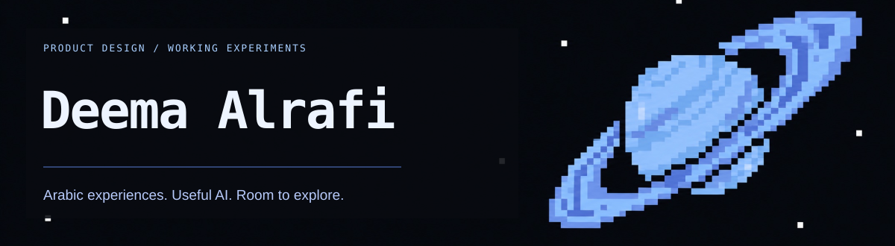
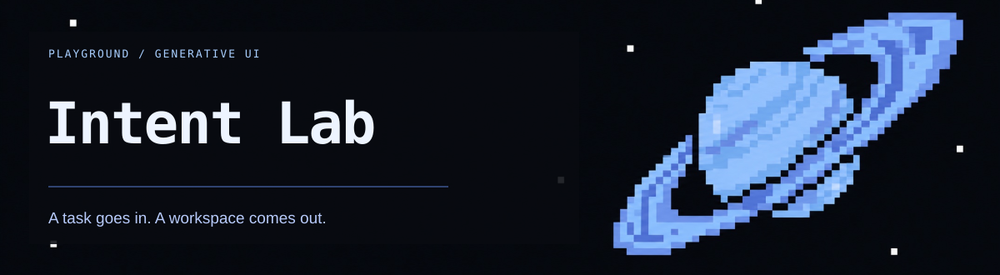
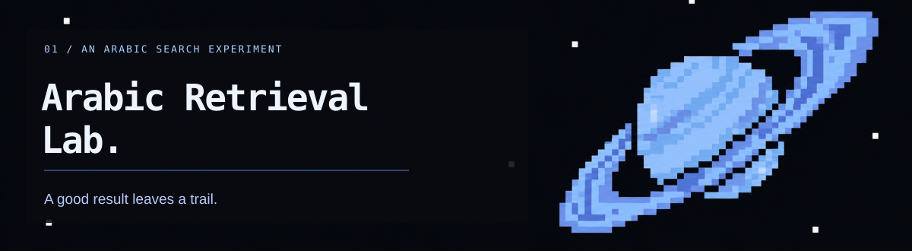
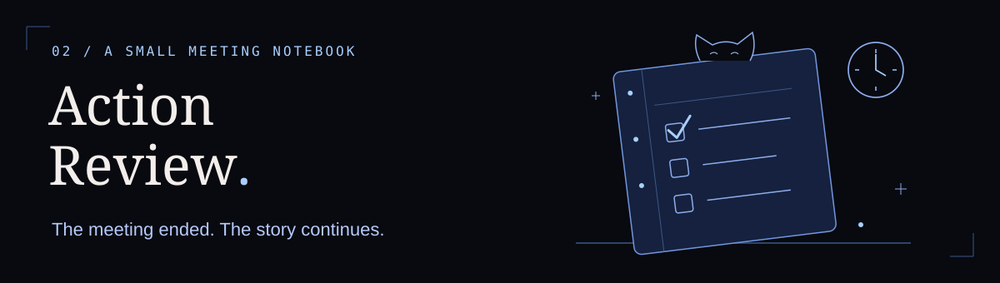
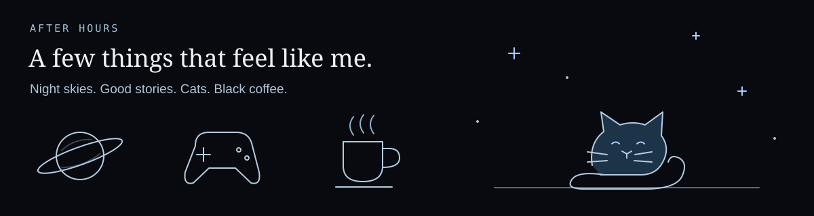
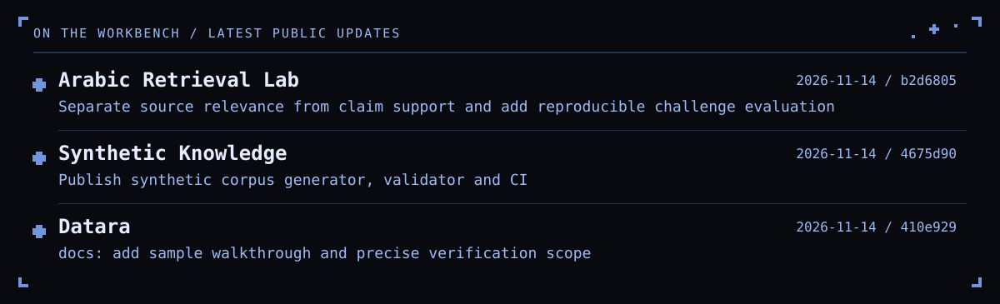

<picture>
  
</picture>

### Senior UI/UX Designer · Applied AI

I’m Deema Alrafi, a Senior UI/UX Designer working on enterprise products since 2023. My work spans research, user journeys and interface design; my computer-science background helps me turn product questions into working experiments.

I focus on Arabic experiences and the decisions people make around AI: checking a source, correcting an output and knowing what to do next.

---

### Try something

**Intent Lab · Generative UI you can use**  
A Generative UI prototype that turns a task into an interactive workspace. Recorded examples and bring-your-own-key generation share a validated component catalog, with spec inspection and workspace export. The hosted prototype includes recorded examples; live generation uses your own OpenAI key.

[Open the playground ↗](https://deema9-intent-lab.static.hf.space/index.html) · [Source, build instructions & decisions](playground/intent-lab/README.md)

**Arabic Retrieval Lab · My main public experiment**  
Import public documents, compare lexical, semantic and hybrid search, and open the exact source passages. Save a local workspace, export the evidence, and verify its quotations offline.

The 40-case synthetic diagnostic compares search methods and documents where they fail. [Read the case study](https://github.com/cometeux/arabic-ai-quality-lab/blob/main/docs/CASE_STUDY.md) · [Architecture](https://github.com/cometeux/arabic-ai-quality-lab/blob/main/docs/ARCHITECTURE.md)

[Open the experiment ↗](https://huggingface.co/spaces/Deema9/arabic-retrieval-lab) · [Code](https://github.com/cometeux/arabic-ai-quality-lab) · [What failed, and why](https://github.com/cometeux/arabic-ai-quality-lab/blob/main/docs/EVALUATION.md)

**The meeting ended. What happens next?** A small notebook for reviewing tasks, owners and deadlines. It flags gaps, keeps editing in your hands and exports the list.

[Open the notebook ↗](https://huggingface.co/spaces/Deema9/action-review) · [Code](https://github.com/cometeux/arabic-ai-quality-lab/tree/main/actions) · [Design decisions](https://github.com/cometeux/arabic-ai-quality-lab/blob/main/docs/DECISIONS.md)

**Also on the workbench**

[Synthetic Enterprise Knowledge](https://github.com/cometeux/synthetic-enterprise-knowledge) — fictional, connected documents for testing retrieval without internal files.  
[Datara](https://github.com/cometeux/data-ai-agent) — a data-analysis workspace prototype with sample data and regression checks.

### Independent venture

**Meyar Prices**  
A price file can look right and still contain an expensive mistake. I’m building an Arabic tool to review Excel prices, compare versions and export the changes — with local file processing.

Around it, I’m testing four AI-agent roles for quality, growth, support and operations, with recorded jobs, retries and clear escalation rules. **14 automated tests passed.** The prototype is pre-launch; merchant-file and payment validation are still pending.

[Product decisions, agent architecture and verification ↗](notes/MEYAR.md)

**Voice capture · Save the thought, sort it later**  
Arabic-first desktop and web explorations that keep notes, ideas, reminders and tasks distinct. [Product note and verification status](notes/VOICE_CAPTURE.md) · [More project notes](notes/PROJECTS.md)

### Product experience

**Smart Meeting Minutes** · UX/UI design  
Helps turn meeting conversations into minutes, decisions and follow-up actions. My design work focuses on reviewing and correcting the output, finalizing the record and following up on tasks. [Design scope and reasoning](notes/MEETING_MINUTES.md).

**Knowledge Companion**  
Helps people find information across a document collection and read answers alongside supporting sources. The aim is to make information easier to find and check.

**Data Protection Layer**  
Explores identifying and masking sensitive information before it enters AI workflows, so useful AI features can work with information that needs careful handling.

*These are confidential projects. Descriptions are intentionally general; their code, interfaces and internal materials are not public. The open experiments above are separate work.*

### How I think about the work

- **Arabic is part of the workflow.** Wording, direction and review states matter as much as the model.
- **Keep evidence visible.** A convincing result still needs a source someone can inspect.
- **Make room for judgment.** A completed field or a high similarity score does not replace a person's decision.

[My direction → changes → evidence](notes/CONTRIBUTIONS.md) · [Evaluation and failure analysis](https://github.com/cometeux/arabic-ai-quality-lab/blob/main/docs/EVALUATION.md) · [Verification record](https://github.com/cometeux/arabic-ai-quality-lab/blob/main/docs/VERIFY.md)

### Try it, then challenge it

Can you find the right source, spot a missing answer, and take the evidence with you? [Try a five-minute review](https://github.com/cometeux/arabic-ai-quality-lab/blob/main/docs/REVIEW_PROTOCOL.md) · [Send a reproducible finding](https://github.com/cometeux/arabic-ai-quality-lab/issues/new?template=independent-review.yml).

Independent feedback is the next milestone. [Review status and follow-up](https://github.com/cometeux/arabic-ai-quality-lab/blob/main/docs/REVIEW_RESULTS.md).

Tools, assistance and credits

I set product direction, constraints and revision priorities. Research, implementation, synthetic examples, tests and documentation use AI assistance. Existing models and upstream work are credited in each repository. [Contribution record](notes/CONTRIBUTIONS.md) · [Upstream fork](https://github.com/cometeux/ai-data-agent).

---

### After hours

A telescope, a story-driven game, another black coffee. Ideally with a cat nearby.

**Orbit Memory** — a small browser game about remembering a constellation. Five rounds, a few stars, and another reason to look twice.

[Play Orbit Memory ↗](https://deema9-intent-lab.static.hf.space/index.html#orbit) · [Source](playground/intent-lab/src/main.jsx)

A little code from before the workspaces

Shapes, colors and a few loops. [My Replit sketchbook](playground/replit/README.md) preserves the original Turtle experiments, including the rough edges and credited starter templates.

What’s moving on the workbench?

Actual public commit dates and messages, refreshed daily. The graphic changes only when the underlying work changes.

