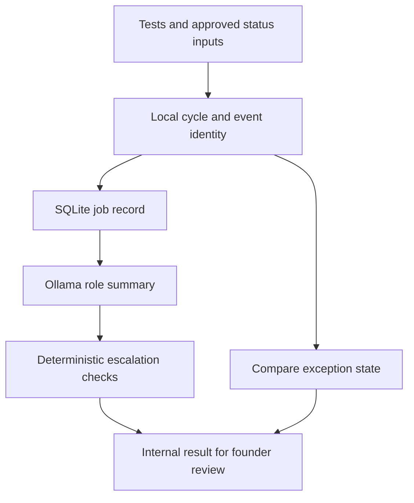

# Meyar Prices

**An Arabic price-review tool, and an experiment in running a small venture with AI agents.**

A spreadsheet can look fine while containing a costly mistake. Meyar helps someone review a product-price file before uploading it: find rows that need attention, compare two versions and export the differences.

## My role

I set the direction as a solo founder: start with no upfront budget, question the initial business idea, ask for evidence before choosing a product, and direct the assisted build. I’m exploring both sides of the work: the product a merchant uses and the operating system a founder needs around it.

Research, implementation, examples, tests and documentation were developed with AI assistance. This is a working prototype before launch, not an operating autonomous company. Development was paused before payment-provider and merchant-file validation.

## The product decisions

| Decision | Why it matters |
|---|---|
| Review spreadsheets locally in the browser | The product workflow does not need a server upload of a merchant’s price file |
| Store prices as integer halalas | Avoid floating-point rounding in price comparisons |
| Reject ambiguous prices and duplicate identifiers | A questionable row should not quietly become a confident price change |
| Keep product and option rows distinct | A variant’s price must not be compared with its parent product |
| Ask when a column match is ambiguous | Make uncertainty visible instead of guessing |
| Preserve original spreadsheet row numbers | Make flagged issues easy to locate and correct |
| Separate preview, test checkout and live checkout | Exploring the product should not accidentally enable selling |

The comparison edition reads before/after XLSX files, separates additions and removals, and exports an Excel review report. The recorded browser check also exercised offline export. That browser check is historical; it was not rerun for this profile update.

## Four agent roles, with boundaries

| Role | What it receives | What it contributes |
|---|---|---|
| Quality | Test counts and template-verification status | A quality summary; failures and unverified compatibility are escalated |
| Growth | Aggregate funnel counts | A proposed acquisition experiment; missing counts remain unknown |
| Support | Allowlisted issue codes | Approved responses for known issues; financial and unknown cases escalate |
| Operations | Availability, checkout and delivery status | An operating summary and exception flags |

The local runner uses Ollama for summaries and SQLite for job records. Inputs are restricted to approved fields, status codes and aggregate counts. Agent text does not authorize actions: deterministic checks decide escalation.

Repeated role/event IDs reuse the recorded result. Failed model calls can be retried. An operating cycle records newly opened and resolved exceptions, avoiding repeated alerts when the underlying condition has not changed.

The roles cannot send messages, spend money, change prices or publish. Recurring scheduling and external alert delivery have not been enabled.

## Verification

On **14 November 2026**, all **14 automated tests passed** when rerun from the local project with Node.js 24.13.0:

- Price parsing, ambiguous columns, row provenance and product/option matching.
- Invalid and duplicate rows excluded from price differences.
- Public-preview isolation and checkout URL validation.
- Live checkout blocked when required evidence is missing.
- Duplicate-event handling, model-failure escalation and retry.
- Exception changes recorded without repeated alerts for an unchanged condition.

The agent tests inject model responses. They verify orchestration behavior, not the quality of a live model. Build tests verify local checkout gates, not a completed payment at the provider. Launch evidence references still require human verification against the original records.

## Before launch

Salla is an intended workflow. The prototype supports a representative layout based on a public template screenshot; **compatibility with an actual merchant export remains unverified**. No Salla partnership or approved integration is implied.

The outstanding checks are a real merchant export, seller approval, test payment success and decline, correct file delivery and order recovery. Real selling remains disabled. There is no claim of customers, revenue, live commercial operation or an unattended company.

## What this work shows

Taking an idea beyond a landing page means deciding what should happen when a price is unclear, a model fails, an event arrives twice or a payment has not been verified. Meyar is where I’m working through those decisions together: Arabic product experience, implementation detail and operational control.

---

This public case study describes the implementation and its verification without publishing runtime databases, account settings, customer files or the private source.
